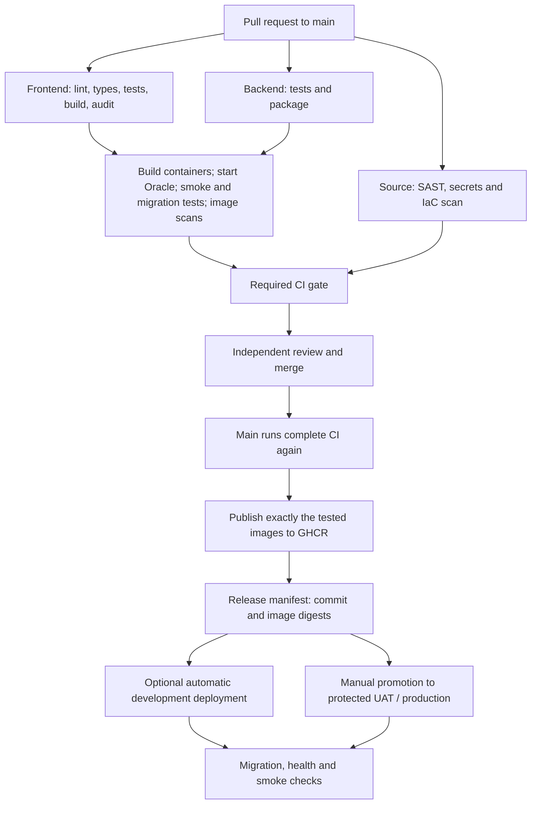

# CI/CD: triggers, gates, publication and deployment

## Pipeline overview



## CI workflow: `.github/workflows/ci.yml`

Runs on PRs to main, pushes to main, manual runs, and a weekly scan/build.
All checks run even for documentation-only changes; there are no path filters
that leave a required check permanently pending.

| Check | Failure blocks |
| --- | --- |
| Frontend checks | Lint/type/test/build errors and high/critical npm advisories |
| Backend checks | Compilation, HTTP/security test failures or packaging errors |
| Source security | Findings in the versioned SAST rules; high/critical secret/IaC findings |
| Containers and Oracle | Build/startup, proxy/health/access smoke checks, Oracle migration tests, high/critical image vulnerabilities |
| CI gate | Any required job failing, being cancelled or being skipped |

PR jobs have read-only repository permission and no deployment credentials. They
run on GitHub-hosted Ubuntu, never the internal deployment runner. Oracle in CI
is disposable, uses generated credentials and synthetic data, and is cleaned up
after the job. CI does not connect to corporate AD or production Oracle.

On a successful **push to main only**, the container job uploads the exact tested
images for the publish job. That job loads them without rebuilding, pushes them
to GHCR, and records their immutable references in `release-manifest/release.json`.
Manual/scheduled/PR CI runs do not publish.

Image names:

```text
ghcr.io/ray-code2/iam-midpoint-integration/frontend:sha-<commit>
ghcr.io/ray-code2/iam-midpoint-integration/backend:sha-<commit>
```

Deployment uses `@sha256:...` digests from the manifest, not mutable tags.
The job's `GITHUB_TOKEN` has package-write permission only for publication.
Package permissions must allow this repository to publish and later read them.

Image transfer artifacts expire after one day; release manifests after 90 days.
Archive approved manifests and retain their registry images longer if the release
retention policy requires it. The supplied promotion workflow needs a retained
manifest; an expired artifact is not a valid unattended rollback path.

## Set up the repository on GitHub

1. Push the feature branch and open a PR to main. Verify the hosted checks.
2. Under Settings > Rules > Rulesets (or branch protection), protect main.
3. Require PRs, one independent approval, conversation resolution, and the exact
   status check **CI gate**. Require the branch to be up to date before merging.
4. Block force pushes/deletion and restrict bypass permissions.
5. Add a second authorized maintainer. CODEOWNERS currently names `@ray-code2`;
   an owner cannot independently approve their own PR.
6. Enable Actions and GHCR access under organizational policy. Review dependency
   update PRs rather than merging them automatically.

These are GitHub settings, not effects of committing workflow files. Private-repo
rules and environment protections depend on the account/organization plan. If a
required control is unavailable, resolve the hosting/approval mechanism before
claiming that gate is enforced. Do not make the repository public to unlock it.

## CD workflow: `.github/workflows/deploy.yml`

Deployment is disabled unless the repository variable `DEPLOYMENTS_ENABLED` is
exactly `true`. Add `DEV_AUTO_DEPLOY=true` only when development is prepared.
Automatic development deployment listens for a successful CI run. Manual
promotion takes a source **CI run ID** and environment choice.

Before any internal runner is used, a hosted preparation job verifies that the
source run is a successful push to this repository's main, was run by `ci.yml`,
and produced a manifest tied to the same commit. It validates registry paths
and digest syntax. Deployment code is checked out from that verified commit.

## Prepare each server/environment

Use isolated Linux deployment runners. They must not run untrusted PR workloads.
Register labels as follows:

| GitHub environment | Runner label |
| --- | --- |
| development | iam-development |
| uat | iam-uat |
| production | iam-production |

Each runner needs Docker with Compose, Bash, Python 3, curl, flock, network access
to GHCR and its environment's Oracle, and sufficient disk. Use a currently
supported Actions runner version compatible with the pinned actions. Provision
`/opt/iam/<environment>` with write access for that runner account. Treat Docker
access as administrative access to its host.

Pre-create GitHub environments. Restrict deployments to main. Set required
reviewers for UAT/production, prevent self-review and restrict bypass according
to policy. Verify that the private repository's plan actually enforces these
protections **before enabling deployment**. A manual trigger is not an approval.

For each environment, configure:

| Setting | Kind | Example / purpose |
| --- | --- | --- |
| JDBC_URL | Environment variable | `jdbc:oracle:thin:@db.internal:1521/IAMDEV` |
| DB_USERNAME | Environment variable | Dedicated IAM environment DB user |
| DB_PASSWORD | Environment secret | Password from the approved secret process |
| APP_PORT | Environment variable | `8088`; must be unused on that host |

The deployment Compose file uses external Oracle; it does not create or destroy
server databases. The app runs Flyway on startup and fails startup on migration
failure. Credentials currently need migration privileges; separate migration
and runtime identities before production. Database target/version, TLS/TNS
configuration, least privilege, backup/restore and compatibility testing require
the database/platform owner.

The portal binds to loopback on the server. Configure an approved HTTPS reverse
proxy/load balancer to reach it, plus external URL monitoring. The built-in
smoke check tests the local HTTP stack; it does not prove external DNS/TLS works.

## First development deployment

1. Configure the development environment, DB, runner, state directory and proxy.
2. Ensure a successful main-push CI run has published images and its manifest.
3. Set `DEPLOYMENTS_ENABLED=true`.
4. In Actions > Deploy > Run workflow, select main, the source CI run ID and
   `development`. Inspect migration, health and smoke evidence.
5. Validate the external HTTPS URL. Once this succeeds, optionally set
   `DEV_AUTO_DEPLOY=true` for future main releases.

Do not enable UAT/production release until their SDLC gates, auth/security work,
database migration privileges and operational controls are satisfied. The
foundation shell is not a production-ready IAM application.

## Failure and rollback

Deployment is serialized per environment in GitHub and with a server-side lock.
The script pulls exact digests, starts the application, waits for health, and
checks portal/proxy/API denial. Only success updates `/opt/iam/<env>/current.json`;
the prior successful record is retained as `previous.json`.

On failure, the workflow fails and does not update the successful-release record.
Containers may already have changed, and a failed Oracle migration may have
partially applied DDL. There is no automatic destructive database rollback.

Recovery procedure:

1. Inspect the failed job, container status and Flyway schema history. Protect data.
2. Ask the DB/release owner whether the previous application is compatible with
   the current schema. Use a forward migration or tested restore if required.
3. If compatible, select the prior successful CI run ID from the release record
   and run Deploy for the same environment. Approval rules still apply.
4. Verify local smoke checks and external HTTPS behavior. Record incident and
   recovery evidence; add a regression test.

Rehearse this in development with disposable data before any production release.

## Official references

- https://docs.github.com/en/actions/get-started/understand-github-actions
- https://docs.github.com/en/actions/how-tos/deploy/configure-and-manage-deployments/manage-environments
- https://docs.github.com/en/packages/working-with-a-github-packages-registry/working-with-the-container-registry
- https://github.com/gvenzl/oci-oracle-free
