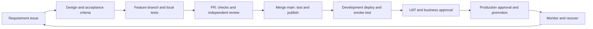

# SDLC: how this project moves from requirement to operation

## Scope

The current delivery is the engineering foundation (blueprint P0/M0) for the
Phase 1 self-service portal (P1). Business priority remains requirements 2, 3, 4.
Foundation completion is not completion of the IAM business application.

## Development lifecycle and gates

| Stage | Work and owner | Evidence required to exit |
| --- | --- | --- |
| 1. Requirements | Product/business owner defines an issue with requirement IDs, actors, allowed/denied actions, acceptance criteria, dependencies | Reviewed issue; unresolved questions explicitly listed |
| 2. Design | Developer proposes API, data, security scope, migration and audit behavior; reviewer checks impact | API/schema notes and an ADR for significant choices |
| 3. Implementation | Developer creates a short feature branch, small change, tests and documentation | Local checks pass; no real identity data or secrets in Git |
| 4. Pull request | Independent engineer reviews behavior, authorization, SQL, failure handling and test coverage | CI gate passes; required review approved; discussions resolved |
| 5. Integration | Merge to main triggers complete CI, then publication of exactly the tested images | Successful CI run; immutable image digests in release-manifest |
| 6. Development | Isolated deployment runner pulls digests, runs startup migrations, verifies health and smoke checks | Successful deployment record with commit and digests |
| 7. UAT | Business testers execute acceptance scenarios; security/operations assess release readiness | Linked UAT results, approval and accepted operational changes |
| 8. Production | Release owner approves promotion; operations checks backup/recovery compatibility | Protected-environment approval and successful smoke checks |
| 9. Operation | Operations monitors errors and audit integrity; developer fixes incidents via reviewed PR | Incident evidence, recovery record, follow-up issue and regression test |

## Responsibilities

- Business owner: scope, UAM/approval semantics, acceptance criteria and UAT sign-off.
- Developer: implementation, meaningful tests, migration compatibility and docs.
- Reviewer: independent review of code, permission boundaries and test evidence.
- Security owner: identity model, threat assessment, scan exceptions and release risk.
- Platform/DB owner: runners, registry, Oracle access, secrets, TLS, backup and restore.
- Release owner: confirms the release candidate and authorizes production promotion.

One person may fill several roles during a local prototype. Independent review and
production approval require another authorized person; the PR author cannot
approve their own PR. Keep this distinction visible during the initial solo setup.

## Definition of ready for a feature

- Requirement ID and user outcome are explicit.
- Actors and ownership boundaries are defined (employee, manager, app owner, admin).
- Acceptance criteria include failure and denied-access cases.
- External dependencies, fixture needs, API contract and database impact are known.
- TBC business decisions are resolved or clearly exclude the affected feature.

## Definition of done for a feature

- Acceptance criteria implemented and demonstrated.
- Required CI gate and independent review pass.
- Tests cover behavior and regression risk, not just file presence.
- Backend authorization and audit expectations are verified where applicable.
- Oracle migrations validate and run against the agreed database version.
- Configuration, deployment, compatibility and recovery notes are updated.
- Development smoke tests and relevant UAT scenarios pass.
- Issue links to PR, CI run, release manifest and deployment evidence.

## Branching and commits

Use trunk-based development with protected `main` and short-lived branches:

- `feat/SSP-02-uam-eligibility`
- `fix/EM-01-approval-scope`
- `chore/ci-dependency-update`

Use descriptive commits such as `feat(workflow): restrict manager approval to owned tasks`.
Open a PR for every change, including pipeline and migration changes. Squash merge
after review and remove the feature branch when no longer needed. No direct main
pushes after bootstrap. Emergency changes still need an incident reference,
reviewed PR, checks and a recovery plan.

## Test strategy

| Layer | Foundation | Phase 1 extension |
| --- | --- | --- |
| Frontend | Health success, network failure, invalid/unhealthy response | Request forms, approval states, history, accessible validation |
| Backend | Public health, denial of business APIs and operational settings | UAM, ownership, delegation, state transitions, audit |
| Oracle | Flyway validation/repeat execution; actual audit insert/read/rollback | Constraints, transactional consistency, upgrade from previous schema |
| Containers | Build, startup, reverse proxy and denied API smoke checks | Authenticated end-to-end pilot and connector failure simulation |
| Security | Local SAST rules, secrets/IaC scan, dependency/image vulnerability gates | Threat model, broader SAST policy, authorization abuse tests, security review |

SAST rules in this baseline cover a small set of dangerous patterns; they are
not a comprehensive IAM security assessment. IAM authorization must be enforced
and tested in backend services before business functionality is exposed.

## Change and incident control

Version Flyway SQL; never edit an applied migration. Prefer additive changes
that allow the previous application image to run. Record breaking changes and
data movement separately. Application rollback does not reverse Oracle DDL.

For a failed deployment, keep the last-known-good release record, inspect the
failed job and migration state, and decide whether a compatible prior image or
a forward database fix is appropriate. Record recovery evidence and add a test
for the incident before closing it.

## Source references and open decisions

- Supplied blueprint: pages 5, 13-17 (phases, stack, CI/CD, repo, milestones).
- Supplied requirements: SSP, EM, PU, IM, ADM and DP identifiers.
- Open: auth provider/AD ownership, development host, Oracle target version,
  independent reviewer, environment approval availability, backups/retention,
  workflow-only handoff, UAM policy details and request-history retention.
